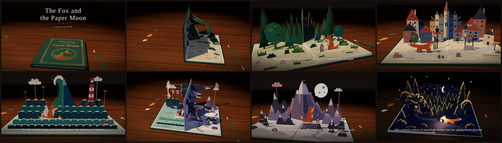

# The Fox and the Paper Moon

A short film, about eighty seconds long, that plays in your web browser. A
pop-up book lies on a wooden desk; its cover opens, and five spreads of cut-paper
scenery stand up one after another while a small paper fox goes looking for a
light for her lantern. Everything you see is drawn live with three.js. There are
no video, image or sound files in it.



## Watch it

**The easy way:** open [`dist/the-fox-and-the-paper-moon.html`](dist/the-fox-and-the-paper-moon.html)
in a browser (download the file and double-click it). It is a single
self-contained file: it needs no server and no internet connection, and you can
send it to someone as an attachment. Any current desktop or mobile browser with
WebGL 2 will play it.

**The development version** (the un-bundled source, as the authors work on it)
needs a small local web server, because browsers do not load ES modules from
`file://`. With Node.js 18 or newer:

```
cd popup-book-film
npm run serve        # then open http://127.0.0.1:8080/
```

The film starts by itself. Sound starts the first time you click or tap the page
(browsers do not allow a page to make sound before that).

**Player controls.** Move the mouse or tap to show the bar: play/pause, a
scrubber with a mark at each chapter, the time and chapter name, sound on/off,
fullscreen, and "Watch again" at the end. The bar hides itself after a few
seconds of playback.

| key / action | does |
|---|---|
| Space or K | play / pause |
| Left / Right arrow | back / forward 5 seconds |
| Home / End | go to the start / the end |
| F, or double-click the picture | fullscreen |
| M | sound on / off |
| click the picture | play / pause (a tap on a touch screen shows the bar) |

**URL parameters** (both versions), e.g. `...the-fox-and-the-paper-moon.html?t=38&autoplay=0`:

| parameter | meaning |
|---|---|
| `t=<seconds>` | start at this time |
| `autoplay=0` | start paused |
| `loop=1` | play again from the start when it ends |
| `controls=0` | hide the player bar (for clean screenshots) |

## The story

The book opens on a title card, *The Fox and the Paper Moon*, and then turns
through five spreads, each with one line of text:

1. **The Paper Forest.** Deep in a paper forest, a small fox found a lantern with no light.
2. **The Sleeping Village.** She asked the sleeping village. Nobody had a spark to spare.
3. **The Folded Sea.** So she folded a boat, and sailed to where the lighthouse blinked.
4. **The Last Mountain.** Up the last cold mountain, the moon hung close enough to touch.
5. **Home.** She carried a sliver of moonlight home, and the whole forest glowed.

Then the book closes, and "The End".

## How it works

- **Everything is a function of film time.** One pure function turns a time `t`
  into the state of the whole film (which page is turning and how far, which
  spread is open, how dark the night is, what the captions say), and every part
  of the picture is computed from that state, in closed form. Nothing
  accumulates from frame to frame and nothing is random at play time, so you can
  jump to any moment and get exactly the same picture every time. That is what
  makes the scrubber, the frame-accurate video export and the automated checks
  possible.
- **A book of rigid card.** The pages are thick card leaves that rotate about one
  hinge line, stacking and unstacking like a bound book. Each spread provides
  three "anchors" (left page, right page, and one that follows the fold between
  them) that the scenery is attached to, so the scenery rides the pages as they
  turn.
- **A cut-paper toolkit.** Shared builders make coloured card cut-outs with
  off-white cut edges and a little thickness: flaps that stand up as a spread
  opens, layered scenery, and true V-folds that span the gutter and fold flat,
  without tearing or passing through the page, as the spread closes. The fox is
  built once and is the same in every spread.
- **One continuous camera take.** The camera glides from shot to shot without
  cuts: slow push-ins and arcs during the scenes, wider framings while the pages
  turn so you can see the pop-ups fold and unfold. It adapts to the shape of the
  window, down to a phone held upright.
- **Procedural sound.** The soundtrack is generated in the browser with the Web
  Audio API, from code.
- **No asset files at all.** Every texture (paper grain, wood, cloth) is painted
  on a canvas when the page loads, and every shape is code.

[`ARCHITECTURE.md`](ARCHITECTURE.md) has the details and the contracts between
the modules: the timeline, the book geometry, the spread anchors, the lighting
and the `window.__film` controller that the tools use.

## Tools

All of these run from `popup-book-film/` with Node.js 18+. `npm install` once
for `build` (it installs esbuild). The browser-driven tools use Playwright with
Chromium, which they expect to find already installed. `render` and `stills`
also need `ffmpeg` on the PATH.

| command | what it does |
|---|---|
| `npm run serve` | serves the development version at http://127.0.0.1:8080/ |
| `npm run smoke` | the smoke test: renders 16 moments into `.smoke/`, fails on any console error or failed request, checks the page anchors numerically and checks that seeking is deterministic |
| `node tools/smoke.mjs --page=dist/the-fox-and-the-paper-moon.html` | the same test against the single-file build, opened from disk; any network request fails it |
| `npm run build` | builds `dist/the-fox-and-the-paper-moon.html`, the single self-contained file |
| `npm run render` | exports the film as an MP4 video (H.264, with the soundtrack as AAC when available) to `out/` |
| `npm run render -- --from=8 --to=20 --width=640 --height=360` | a shorter, smaller excerpt; also `--fps`, `--workers`, `--crf`, `--out`, `--page`, `--keep-frames` |
| `npm run stills` | renders eight moments and tiles them into `docs/contact-sheet.jpg` (the times are listed at the top of `tools/stills.mjs`) |
| `node tools/paper-shots.mjs` | screenshots and a geometric check of the cut-paper toolkit bench |
| `npm run serve`, then open `/dev/paper.html` | the toolkit bench: one spread with every paper builder on it, and a slider to open and close it (`?open=0.6&cam=low&night=1`) |

The video export does not record the film playing in real time. It seeks to
every frame (frame *i* is at time *i*/30 s), so the result is smooth however
slow the machine is, and it renders in several browser instances in parallel.
An interrupted render continues where it stopped when you run the same command
again. In a browser without a graphics card the film draws in software, so a
full 1280x720 export takes a while.

## How it was made

The film was built in one session by a planner/worker team of AI agents. A
planning model wrote a brief for each task, reviewed every result (running the
smoke test and looking at rendered frames) and merged the work; it never edited
a file itself. Claude Opus 5.5 worker agents wrote all of the code, up to three
at a time in parallel, each in its own git worktree with its own files.

| task | work |
|---|---|
| T0 | walking skeleton and contracts |
| T1 | cut-paper toolkit, fox and lantern |
| T2 | book and lit stage |
| T3 | camera, titles and player |
| T4 | forest and village spreads |
| T5 | sea and mountain spreads |
| T6 | night finale |
| T7 | soundtrack |
| T8 | build, video export, stills and this README |
| T9 | polish pass from the review |

## Credits

The film uses [three.js](https://threejs.org) r187, which is vendored in
`vendor/three/` under the MIT License (see [`vendor/three/LICENSE`](vendor/three/LICENSE));
the single-file build carries the same notice. The film's
own code and images carry no separate licence statement.
