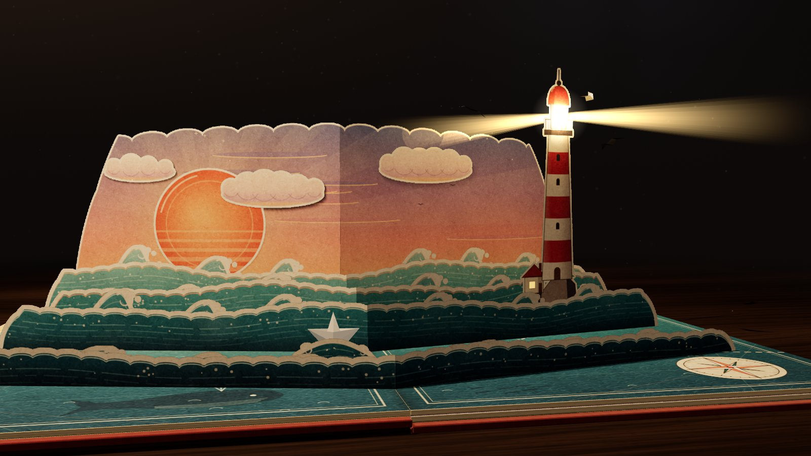
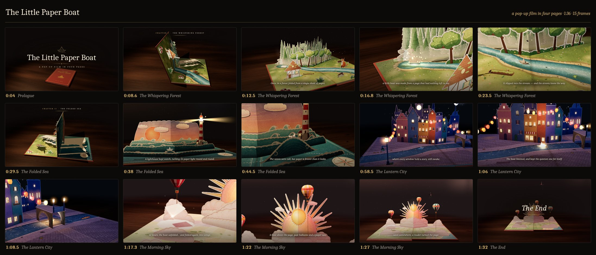

# The Little Paper Boat

*A 96-second pop-up-book film that is not a video. It renders live in your browser with three.js.*



A pop-up book lies on a walnut desk under a warm lamp. The cover opens, and four paper worlds rise
one after another as the pages turn. A little folded-paper boat sails through a forest, across the
sea, into a lantern-lit city at night, and finally into a dawn sky, where it unfolds and folds
again into a paper crane. Storybook captions narrate the story and a music-box score plays.

Nothing is downloaded. All the paper art is painted on canvas when the page loads, every pop-up is
real folding geometry posed by its opening angle, and the music is synthesized with WebAudio.
There's no build step and no runtime dependency other than a vendored copy of three.js r170.

## Watch it

From this folder:

```sh
node tools/serve.mjs          # serves popup-film/ at http://127.0.0.1:8080/
node tools/serve.mjs 3000     # …or on another port
```

Open the printed URL and press **Begin**. The film runs about 1½ minutes and is best with sound.
Any static file server works too (`python3 -m http.server`, `npx serve`, …). The page must be
served over `http://` because ES modules and the import map don't load from `file://`. The
bundled server only listens on 127.0.0.1. To watch on a phone, use a server that is reachable
on your network. The layout works at phone width, in portrait and landscape.

You need a browser with WebGL 2 (any current Chrome, Edge, Firefox or Safari). Sound starts on
your first click or key press, as browsers require.

If something goes wrong, the film says so instead of freezing:

- **No WebGL, or the film fails to load:** the title card shows a short message instead of the
  loading animation. This also covers code that can't load at all, for example in a sandboxed
  frame.
- **The graphics driver drops the picture** (WebGL context lost): the film pauses behind a short
  notice and resumes when the browser restores it.
- **No full screen available** (some iframes, some phones): the full-screen button is hidden,
  and a refused request is ignored.
- **Reduced motion:** with `prefers-reduced-motion`, the camera's handheld drift and lens
  breathing are off, and the captions fade without drifting.

## Controls

| Input | What it does |
|---|---|
| **Begin** (or Enter / Space on the title card) | starts the sound and plays from the beginning |
| Click on the film | play / pause |
| Double-click on the film | full screen |
| Tap (touch) | shows hidden controls; a second tap plays/pauses |
| Scrubber | drag to seek (pauses while you drag, then resumes); hover shows time + chapter |
| Control bar | play/pause/replay, time, current chapter, mute, full screen |
| **Read it again** | appears at the end; plays the film again from the start |

The controls and cursor hide after 2.5 s without input while the film plays. Your mute choice is
remembered in `localStorage`.

### Keyboard shortcuts

| Key | Action |
|---|---|
| Space | play / pause |
| ← / → | back / forward 5 s |
| Home | restart from the beginning (and play) |
| M | mute / unmute |
| F | full screen |
| ↑ / ↓ *(scrubber focused)* | forward / back 5 s |
| PageUp / PageDown *(scrubber focused)* | forward / back 15 s |
| End *(scrubber focused)* | jump to the end |

The shortcuts also work with `ui=0`.

### URL parameters

| Parameter | Effect |
|---|---|
| *(none)* | poster frame (t = 20 s) behind the title card; **Begin** plays from 0 |
| `t=<seconds>` | opens paused at that time, without the title card |
| `play=1` | plays immediately, from `t` if it is given, otherwise from 0 |
| `ui=0` | no controls and no title card, which gives clean frames for screenshots (`?t=38&ui=0`) |
| `mute=1` | starts muted |
| `free=1` | replaces the camera rig with an orbit camera (drag to orbit; for debugging) |

If a parameter appears more than once, the last occurrence wins. For automation the page exposes
`window.__film = { seek(t), play(), pause(), time, playing, duration }` and sets
`window.__ready = true` once the scene has rendered at least two frames at the requested time.

## The story in four pages

| Time | Chapter | What happens |
|---|---|---|
| 0:00 | Prologue | The desk lamp clicks on and warms up (0.3–2.8 s). The title card floats over the closed book. |
| 0:07 | I · The Whispering Forest | The cover opens (7–10 s) and pines, firs, a cottage and a fox rise out of the gutter. A lost page on the spring folds itself into a boat (15.5–18 s) and sails down the stream (20.5–27.5 s). |
| 0:28 | II · The Folded Sea | The page turns (28–31 s) onto a paper-theatre sea at sunset with parallax wave rows. The lighthouse beam turns (37–42 s) and a big wave lifts the boat (42–46 s). |
| 0:49 | III · The Lantern City | Night falls with the page turn (49–52 s). The windows light up one by one (53–62 s), and the light of the quiet window floats down into the boat (63–66 s). The boat passes under the bridge (~68.5 s). |
| 1:10 | IV · The Morning Sky | Dawn comes (70–73 s). The boat unfolds into a flat square and refolds into a crane (75.6–78.5 s), which flies up past balloons and a rising paper sun. |
| 1:29 | The End | "The End" appears at 89.5 s. The lamp fades out (89–95.5 s) and the picture fades to black (93.5–96 s). |



## How it's made

### Paper craft
Every piece of art is painted procedurally with Canvas2D at load time: layered shapes, ink line
work and highlights. Then [`paper.js`](src/paper.js) adds the paper itself: fibre grain, tooth
and low-frequency mottling. Cut-out pieces get a **die-cut border**, a white paper margin grown
around the silhouette with a faint darker cut line on its rim, just like a punched pop-up piece.
Cards are double-sided: a printed front and a plain cream back cut to the same silhouette. They
are alpha-tested, so their shadows have the right shape. Their textures fill transparent texels
with the colour of the nearest opaque texel, so mipmapping never pulls a dark fringe into a cut
edge. Each page is a 768 × 1024 canvas. The boat and the crane are real folded paper models, and
the crane's wings are posed by `setFlap(v)`.

### Pop-up mechanisms
[`popup.js`](src/popup.js) is the paper engineering. Every mechanism is pure math, posed as a
function of the spread's opening angle α (0 = closed, π = flat open), and every pose is computed
in closed form:

- **V-fold.** A card is folded along its centre crease and its two halves are glued to the two
  pages along lines at angle γ from the gutter. The card corner is 90°, so the crease is
  perpendicular to both glue lines. Its direction is therefore the cross product
  **c = normalize(d<sub>L</sub> × d<sub>R</sub>)** of the two glue-line directions, which is
  regular for every α. With γ < π/2 the V opens toward the reader (valley). With γ > π/2 the
  vertex points at the reader (mountain, for tall back layers).
- **Stand-up.** A flat piece on one page, hinged perpendicular to the gutter, that stands at α/2.
  It never pierces the facing page while its height ≤ x − width/2.
- **Floating layer.** A platform raised on two parallelogram walls, so it stays parallel to the
  pages. Its frame is a whole sub-spread that other mechanisms can be nested on. The city's
  arched bridge is two of these, used as a box fold.
- **Slider** (a pull-tab path, arc-length parametrised) and **onPage** (flat on a page) round out
  the set.

All pieces obey three **folding rules**. R1: closed, every footprint fits inside the page. R2:
each piece stays between its page and the bisector plane. R3: footprints on the same page don't
overlap. Together they guarantee that nothing ever pierces a page or another piece, and that the
book closes flat. The spreads go one step further: all of a spread's V-folds share one γ, so
their halves are parallel planes at every angle and stack neatly as the page closes. The
mechanisms, the book and the forest, sea and city spreads have numeric self-tests (see the dev
pages).

### The book
[`book.js`](src/book.js) builds a hardcover with five leaves: the front cover, three printed
boards and the back cover. They are linked as a **hinge chain**. Each leaf turns about its own
gutter edge, and that edge rides on the edge of its neighbour. As a result, both printed surfaces
of a spread start on the same line at every angle, even mid-turn, so the gutter stays clean and
no two leaves ever overlap. The chain is then lifted so that its lowest corner rests on the
desk. The cover is woven red book cloth with a gold-foil title and boat emblem, and the foil
reflects its own small warm environment. A soft strip of shade runs along every gutter.

### Light
[`environment.js`](src/environment.js) owns the desk (procedural walnut under a clear coat), the
dark room with an out-of-focus window, and 320 dust motes drifting in the lamp beam. It also
owns the film's only shadow-casting light: a warm spotlight "desk lamp" at the upper left, with
2048² soft PCF shadows. The schedule:

| Time | Lighting |
|---|---|
| 0.3–2.8 s | the lamp flickers on and warms from amber to incandescent |
| 49–52 s | night: the lamp dims to 0.35 and narrows; cool teal moonlight comes in from the front right |
| 70–73 s | dawn: the lamp rises to 1.1 and a low warm-pink light comes in from the right |
| 89–95.5 s | the lamp fades to nothing |

### Camera
[`camera.js`](src/camera.js) is a virtual camera rig with 36 keyframes. Each channel (position,
target, lens, handheld amount) is a cubic Hermite spline with shape-preserving tangents, so moves
never overshoot and never jerk. Follow keys ride the boat's journey and aim where it will be
0.45 s later. A small deterministic handheld drift and some lens breathing make it feel filmed;
both are off when the viewer prefers reduced motion. On narrow screens the rig widens the lens and dollies back, so the book stays in frame down to
portrait phones.

### Score
[`audio.js`](src/audio.js) synthesizes a music box with WebAudio. A four-bar lullaby motif in
D major is varied for each page: rocking 3/4 at 72 BPM in the forest, augmented over rolling
arpeggios at sea, D minor at 60 BPM with distant chimes in the city, and G major at 80 BPM
rising at dawn, resolving A7 → D on "The End". Paper foley is built from seeded noise: the lamp
click, the cover creak, page whooshes panned with the turning leaf, pop-up flaps, landing thumps
and rustles. Sea and wind ambience run underneath. The whole score is one event list in film
seconds, so seeking anywhere restarts the music in the right place.

## Module map

| File | Responsibility | Lines |
|---|---|---|
| [`index.html`](index.html) · [`styles.css`](styles.css) | page shell, intro/poster card, all UI styling | 68 · 733 |
| [`src/main.js`](src/main.js) | boot, warm-up pass, frame loop, light proxies, context-loss handling, URL parameters, test hooks | 510 |
| [`src/ui.js`](src/ui.js) | control bar, scrubber, keyboard and pointer input, auto-hide | 427 |
| [`src/timeline.js`](src/timeline.js) | master schedule, easing, leaf angles, wall-clock `Player` | 137 |
| [`src/util/rng.js`](src/util/rng.js) | seeded random numbers (mulberry32) | 29 |
| [`src/paper.js`](src/paper.js) | palettes, grain, die-cut, cards, paper materials, boat, crane | 767 |
| [`src/popup.js`](src/popup.js) | pop-up mechanisms and folding rules | 562 |
| [`src/book.js`](src/book.js) | the hinged book, cover, page materials, spread anchors | 855 |
| [`src/environment.js`](src/environment.js) | desk, room, lamp and light schedule, dust motes | 573 |
| [`src/camera.js`](src/camera.js) | camera rig: shot keys, splines, boat following | 409 |
| [`src/titles.js`](src/titles.js) | title card, chapter labels, captions, "The End", fade to black | 353 |
| [`src/audio.js`](src/audio.js) | procedural score, foley and the scheduler | 934 |
| [`src/spreads/forest.js`](src/spreads/forest.js) | I · The Whispering Forest | 2086 |
| [`src/spreads/sea.js`](src/spreads/sea.js) | II · The Folded Sea | 1491 |
| [`src/spreads/city.js`](src/spreads/city.js) | III · The Lantern City | 2199 |
| [`src/spreads/sky.js`](src/spreads/sky.js) | IV · The Morning Sky | 1591 |
| [`src/spreads/index.js`](src/spreads/index.js) | the four spreads in film order | 9 |

That makes about 13,700 lines of film code in total, plus ~2,500 lines of dev harnesses. The
architecture (conventions, the spread frame, APIs, schedule and rules) is documented in
[`docs/ARCHITECTURE.md`](docs/ARCHITECTURE.md).

## Dev harness pages

Every module has its own standalone page in [`dev/`](dev/). Serve the folder and open, for
example, `http://127.0.0.1:8080/dev/spread-sea.html?view=low&t=44`.

| Page | Shows | Parameters |
|---|---|---|
| `dev/paper.html` | die-cut cards, a split V-fold, boat and crane on a paper spread | `cam=wide\|close\|boat\|crane\|back\|top`, `solo=boat\|crane` (+ `yaw`, `pitch`, `dist`), `flap=-1..1`, `hud=1`, `free=1` |
| `dev/popup.html` | every mechanism with labelled test cards, cross-section insets; numeric self-test over 200 angles | `alpha=0..1` (×π), `u=0..1` (slider), `anim=1` |
| `dev/book.html` | the book with test art and axes on the spread anchors | `t`, `cam=front\|gutter\|low\|spine\|cover\|top\|three`, `check=1` (sweeps the film for overlaps and gutter fit) |
| `dev/environment.html` | desk, room and lamp with a stand-in book | `t`, `view=low\|wide\|close\|top`, `free=1`, `lamp=x,y,z` |
| `dev/titles.html` | the caption layer over a cheap 2D stand-in film | `t`, `play=1`, `bg=paper` (worst-case contrast), `ui=0` |
| `dev/audio.html` | renders the whole score offline, level plot, checks, live playback buttons | none |
| `dev/camera.html` | the film through the rig, with a marker on the boat and caption guides | `t`, `marker=0`, `guides=0`, `titles=0` |
| `dev/spread-forest.html` | spread I alone (layout self-test over 360 angles) | `alpha`, `t`, `play=1`, `free=1`, `view=front\|wide\|low\|top\|left\|boat\|birth` |
| `dev/spread-sea.html` | spread II alone | `alpha` (or `film`), `t`, `view=front\|low\|light\|boat\|wide\|top\|side`, `free=1`, `hud=1`, `check=1` |
| `dev/spread-city.html` | spread III alone | `alpha` (or `auto`), `t`, `view=front\|wide\|low\|top\|boat\|window\|bridge\|side\|wedge`, `free=1`, `check=1` |
| `dev/spread-sky.html` | spread IV alone | `alpha`, `t`, `view=front\|wide\|low\|top\|side\|boat\|crane\|fold\|gutter`, `play=1`, `free=1` |
| `dev/smoke.html` | a spinning cube that proves the toolchain works | none |

## Tools

All three run with Node 18+ and need no `npm install`. The two Playwright tools use a global
Playwright with Chromium and render with software WebGL (SwiftShader), so they work on headless
machines.

- **`tools/serve.mjs [port=8080]`** is a dependency-free static server for this folder. It also
  exports `startServer()` for the other tools.
- **`tools/snap.mjs --out <dir> [--page index.html] [--times 0,8.5] [--query "k=v"] [--size 1280x720] [--timeout ms]`**
  takes a headless screenshot of the film (or any dev page) at the given times. It prints a JSON
  summary and exits 1 on any console error, page error or failed request.
- **`tools/contact-sheet.mjs [--out media] [--only poster|sheet] [--poster 38] [--times …] [--thumb 416x234] [--quality 0.85] [--frames <dir>]`**
  renders this README's media: the 1600 × 900 poster frame and the labelled contact sheet. It
  loads the film once and seeks from frame to frame, which works because the film is a pure
  function of time.

### Publish as a single page

Some hosts wrap a page in their own document and sandbox it, which breaks the import map and
module loading. For those hosts, build one self-contained file:

```sh
node tools/build-artifact.mjs --out <dir>     # writes <dir>/index.html
```

The output is a single HTML page with the CSS and an esbuild bundle of the whole film, three.js
included, inlined. It makes no network requests. The first run fetches esbuild through `npx`.

## How this was built

The film was written entirely by AI coding agents working as a small team.

- **An orchestrator agent** planned the work. It wrote the architecture contract (world
  conventions, the spread frame, every module API, the master schedule and the boat's journey)
  and a design brief for each task. It reviewed every result by reading the code and looking at
  screenshots. It edited no project files itself.
- **Worker agents** wrote all of the code, in parallel batches:
  1. **Foundation:** the vendored three.js, the timeline, the seeded RNG, module stubs and the
     screenshot tool.
  2. **Modules:** main + UI, paper, pop-up mechanisms, the book, the environment, titles and
     audio, all built at the same time against the contract.
  3. **Spreads + camera:** forest, sea, city, sky and the camera rig.
  4. **Integration and QA, plus these docs.**

Each worker owned its own files, built a dev harness page for its module, and checked its work
with numeric self-tests and screenshots before reporting back.

## Credits

- [three.js](https://threejs.org/) r170 by the three.js authors, MIT licensed. See
  [`vendor/LICENSE`](vendor/LICENSE). The film also uses its `OrbitControls` and
  `RoundedBoxGeometry` add-ons.
- [esbuild](https://esbuild.github.io/) (MIT) is used only by `tools/build-artifact.mjs`, at
  build time.
- Everything else (art, geometry, music, sound and typography, which uses system fonts) is
  generated by the code in this folder.
